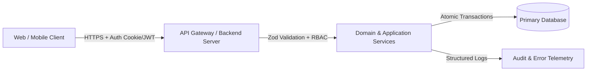
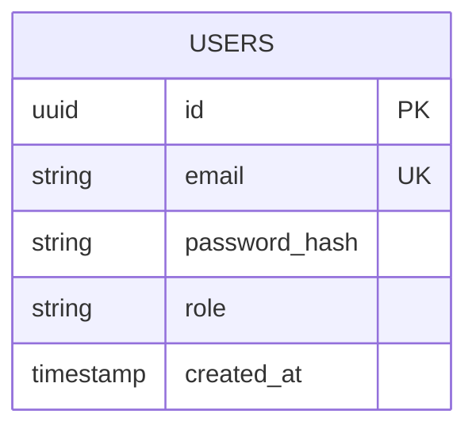

# 03 — System Architecture & Red-Team Blueprint

> **Stage 3A Artifact (`zerodrift-architect`).** Locks system topology, data schema, module boundaries, ADRs, and Red-Team risk mitigations. Paired with `.zerodrift/CONTRACTS.md` and `.zerodrift/05-TASKS.md`.

## 1. System Topology & Runtime Diagram

- **Deployment Model:** `{{FILL: e.g., Single-repo modular monolith on Node 22 + PostgreSQL}}`
- **Single Backend Entry Point:** `{{FILL: e.g., src/server/index.ts}}`
- **Single Frontend Entry Point:** `{{FILL: e.g., src/client/main.tsx}}`

---

## 2. Module Boundaries & Dependency Direction

Strict unidirectional layering: `Routes / UI -> Services / Use Cases -> Domain Logic -> Repositories / DB`.

| Module | Directory | Owns (Data & Logic) | Allowed Dependencies | Forbidden Dependencies |
| :--- | :--- | :--- | :--- | :--- |
| `auth` | `{{FILL: src/modules/auth}}` | Sessions, passwords, RBAC guards | `db`, `shared` | Feature UI, other modules' internals |
| `{{FILL: core}}` | `{{FILL: src/modules/core}}` | `{{FILL: Domain entities & rules}}` | `db`, `auth`, `shared` | Direct raw HTTP frameworks in domain |

---

## 3. Entity-Relationship Diagram (ERD)

*(Expand with all domain entities, foreign keys, unique constraints, and performance indexes; exact SQL/ORM columns are locked in `CONTRACTS.md`.)*

---

## 4. Architecture Decision Records (ADRs)

| ADR ID | Decision | Alternatives Considered | Rationale & Trade-offs |
| :--- | :--- | :--- | :--- |
| `ADR-01` | `{{FILL: Chosen stack/pattern}}` | `{{FILL: Rejected alternative}}` | `{{FILL: Why chosen for simplicity, reliability, and team fit}}` |

---

## 5. Error Handling, Transactions & Observability Strategy

- **Error Envelope:** Standardized JSON `{ error: { code, message, details?, requestId } }` from a single centralized error handler.
- **Transaction Boundary:** Multi-table writes and financial/inventory mutations execute inside explicit DB transactions.
- **Audit Logging:** Security-sensitive and state-changing actions record `actorId`, `action`, `resourceType`, `resourceId`, `timestamp`, and `metadata`.

---

## 6. Mandatory Red-Team Challenge Pass (Top 5 Risks & Mitigations)

| Risk # | Failure Plane | Weak Assumption / Threat | Concrete Mitigation Baked Into Architecture |
| :---: | :--- | :--- | :--- |
| 1 | Data Integrity & Concurrency | `{{FILL: e.g., Double submission / race condition}}` | `{{FILL: Unique idempotency key + transactional lock}}` |
| 2 | Security & Blast Radius | `{{FILL: e.g., Cross-tenant IDOR on /api/records/:id}}` | `{{FILL: Mandatory tenantId predicate in every repository query}}` |
| 3 | Scale & Bottlenecks | `{{FILL: e.g., Unbounded list endpoints / N+1 queries}}` | `{{FILL: Cursor/offset pagination capped at 100 + eager joins + indexes}}` |
| 4 | Split-Brain / Wiring Drift | `{{FILL: e.g., Client-computed totals differing from server}}` | `{{FILL: Server recomputes all totals; shared Zod schemas in CONTRACTS.md}}` |
| 5 | UX / Operational Resilience | `{{FILL: e.g., Silent failure on network drop or RTL overflow}}` | `{{FILL: Typed error UI with retry; logical CSS properties enforced}}` |

---

## 7. Blueprint Visualization Status

- **Floorplan Pre-Code Blueprint:** `{{FILL: Generated at floorplan/index.html | Skipped (floorplan not installed)}}`
- **Gate 3 Approval:** `{{FILL: Pending | Approved on YYYY-MM-DD}}`

