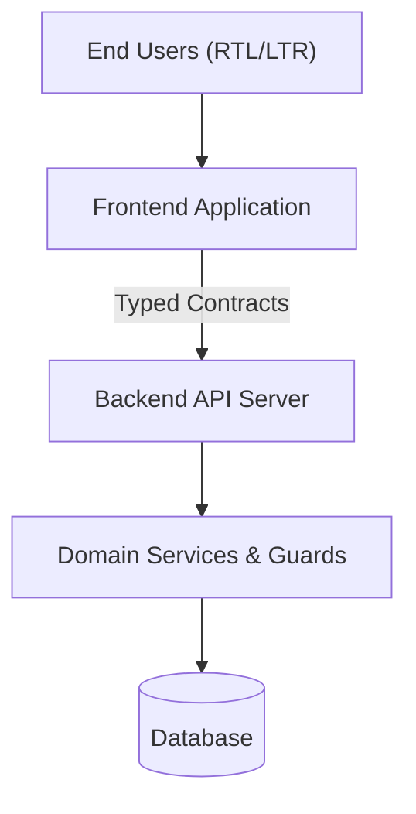

# 06 — Final Handover, Provenance & Module Operations Pack

> **Stage 7 Artifact (`zerodrift-handover`).** Complete executive, user, developer, compliance-provenance, and operations handbook for `{{PROJECT_NAME}}`.

## 1. Executive System Overview

- **Product:** `{{PROJECT_NAME}}`
- **Delivery Date:** `{{DATE}}`
- **Stack Summary:** `{{FILL: Verified stack & versions}}`
- **Architecture Diagram:**
  - Interactive Archify / Floorplan Artifacts: `{{FILL: Link or N/A}}`



---

## 2. Module-by-Module User & Developer Guide

### Module 1: `{{FILL: Module Name}}`
- **What It Does:** `{{FILL: Business capability}}`
- **Who Uses It (RBAC):** `{{FILL: Authorized roles}}`
- **Step-by-Step User Workflow:**
  1. `{{FILL: Exact screen/action step}}`
- **Key Source Files & Endpoints:**
  - Routes: `{{FILL: Method + Path from CONTRACTS.md}}`
  - Key Files: `{{FILL: Exact relative paths}}`
- **Enforced Business Rules & Safeguards:**
  - `{{FILL: Exact domain invariants enforced server-side}}`

---

## 3. Standards, Compliance & Sources Provenance Ledger

*(Consolidated from `.zerodrift/02-RESEARCH-SOURCES.md` so auditors, clients, and maintainers can verify every domain rule and library reference.)*

| Ref ID | Standard / Library / Regulation | Official Source / URL | Rule Implemented | Module(s) | Status |
| :--- | :--- | :--- | :--- | :--- | :---: |
| `STD-01` | `{{FILL: Standard / Doc}}` | `{{FILL: URL / Ref}}` | `{{FILL: Concrete rule}}` | `{{FILL: Module}}` | `VERIFIED` |

---

## 4. Verification & Security Sign-Off Summary

Every check below was executed against the final codebase state:

| Verification Gate | Exact Command / Audit Run | Exit Code / Verdict | Notes |
| :--- | :--- | :---: | :--- |
| Typecheck / Compiler | `{{FILL: npx tsc --noEmit}}` | `0` | Zero errors |
| Production Build | `{{FILL: npm run build}}` | `0` | Clean bundle |
| Dead Code & Orphans | `{{FILL: npx knip or static check}}` | `0` | Zero unintended orphans |
| Dependency Graph / Cycles | `{{FILL: depcruise or graph check}}` | `0` | Zero runtime cycles |
| Contract & Wiring Parity | `CONTRACTS.md` vs live routes/clients | `PASS` | 1:1 parity verified |
| Automated Tests | `{{FILL: npm test}}` | `0` | Critical logic + auth covered |
| Runtime / Browser Check | Live boot + critical flow verification | `PASS` | Zero console/404/500/CORS errors |
| Security Audit (`05-SECURITY-AUDIT.md`) | `zerodrift-security` | `PASS` | `0` P0, `0` P1 unresolved |

---

## 5. Deployment, Environment & Operations Runbook

### 5.1 Required Environment Variables
*(Mirrors `CONTRACTS.md` — never commit real values to git.)*
- See `.env.example` for the complete template.

### 5.2 Local Development & Production Commands
```bash
# 1. Install dependencies
{{FILL: npm ci}}

# 2. Apply database migrations & idempotent seed
{{FILL: migration & seed command}}

# 3. Verify build & tests
{{FILL: build & test command}}

# 4. Start production server
{{FILL: start command}}
```

### 5.3 Backup, Rollback & Incident Recovery
- **Database Backups:** `{{FILL: Backup cadence & restore command}}`
- **Rollback Procedure:** `{{FILL: Safe release rollback steps}}`
- **Known Deferred Items (P2/P3 or v2 Backlog):** `{{FILL: Explicit list or None}}`

